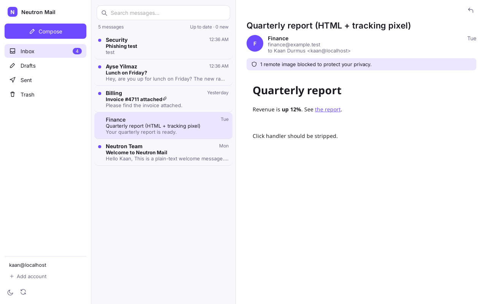
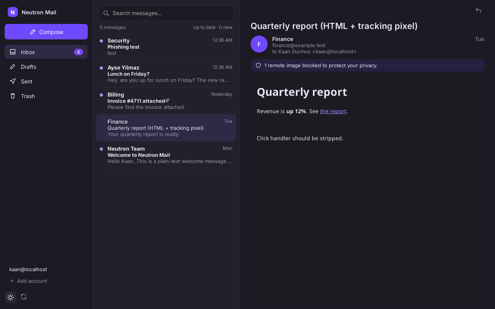
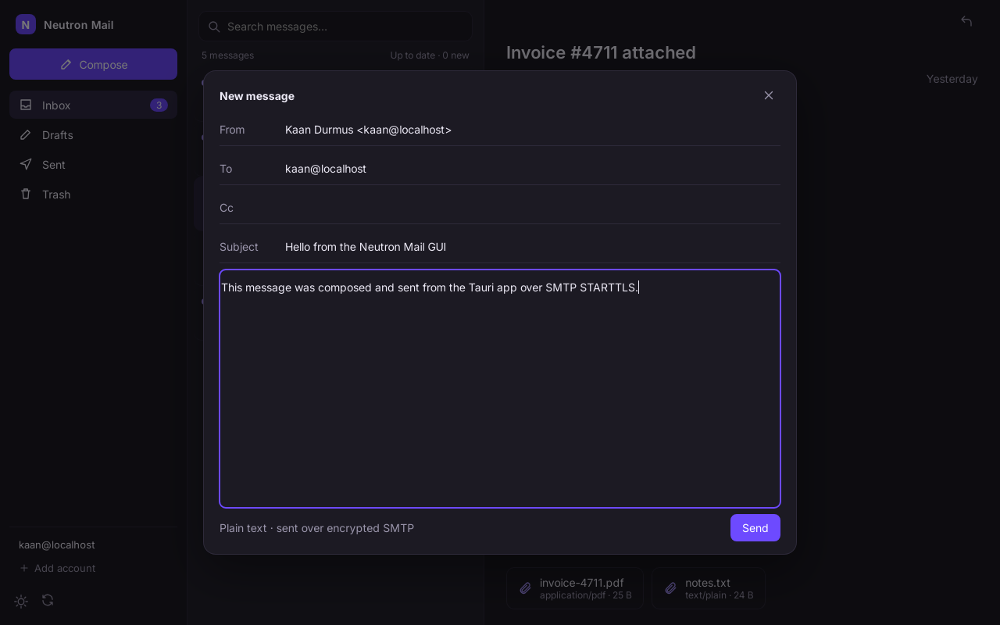

# Neutron Mail

A free, open-source desktop mail client inspired by modern privacy-focused webmail layouts, built for **your own IMAP/SMTP server** and **Fedora 44 GNOME**.

- **Core:** Rust (tokio, async-imap, lettre, mail-parser, ammonia, rustls, SQLite FTS5, keyring)
- **Shell:** Tauri v2 (WebKitGTK 4.1)
- **UI:** Svelte 5 + TypeScript + Vite (original design)
- **GNOME integration:** Contacts & Calendar via evolution-data-server, GNOME Online Accounts, `mailto:` handler, notifications

> **Not affiliated with Proton AG.** Neutron Mail uses **no Proton code, name, logos, or assets**. "Proton" is a trademark of Proton AG; it is mentioned in the docs only to describe design inspiration and prior-art research.

## Status

**Working prototype (v0.1.0).** Verified against a local Dovecot + SMTP test server:
add an account (IMAP/SMTP over TLS or STARTTLS, certificate always verified), folder list,
message list from a local SQLite cache, a sanitized HTML viewer (sandboxed iframe, remote
images blocked), plain-text compose and send (with a copy saved to Sent), full-text search,
and IMAP IDLE push with a polling fallback. GNOME Contacts/Calendar are stub interfaces only.

- 🔐 [Security audit](docs/AUDIT.md): findings, severities, fixes and known gaps
- 📄 [Research report](docs/research-report.md): architecture, crates, GNOME integration, licensing
- 🎨 [UI concepts](concepts/README.md) · 📸 [Prototype screenshots](docs/screenshots/)

| Inbox + HTML viewer (light) | Remote image blocked (dark) | Compose |
|---|---|---|
|  |  |  |

### Why Svelte (not React)
Svelte compiles to plain DOM code with no runtime: a 66 KB JS bundle (25 KB gzipped) and a single
runtime npm dependency (`@tauri-apps/api`). That keeps the WebView small and the supply-chain
audit surface minimal, which matters for an app that handles mail.

## Build & run on Fedora 44

> The prototype was developed and tested on Debian 13 (the build box). The Fedora commands
> below follow Tauri v2's documented Fedora prerequisites but were **not run on Fedora**.

```bash
# 1. System dependencies
sudo dnf install -y webkit2gtk4.1-devel openssl-devel curl wget file \
  libappindicator-gtk3-devel librsvg2-devel libxdo-devel nodejs npm \
  gnome-keyring libsecret
sudo dnf group install -y c-development

# 2. Rust (>= 1.85) via rustup, plus the Tauri CLI
curl --proto '=https' --tlsv1.2 -sSf https://sh.rustup.rs | sh
cargo install --locked tauri-cli@^2

# 3. Build and run
npm ci
cargo tauri dev            # development (hot-reload UI)
cargo tauri build          # release build + .rpm / .deb bundles in target/release/bundle/
```

Passwords are stored in the GNOME Keyring (Secret Service). Without a keyring, the app falls back
to keeping them **in memory only** for the session and shows a warning. They are never written to disk in plaintext.
Set `NEUTRON_LOG=debug` for verbose logs (they never contain passwords or message bodies).

## Testing

```bash
cargo test --workspace                          # unit + offline tests (network tests auto-skip)
cargo clippy --workspace --all-targets -- -D warnings
npm run check && npm run build                  # svelte-check (warnings fail) + Vite build

# Integration tests against a local mail server (all bound to 127.0.0.1)
sudo dnf install -y dovecot python3-aiosmtpd openssl   # Debian: dovecot-imapd python3-aiosmtpd
export NM_TEST_BASE=/tmp/neutron-testmail
testserver/start.sh       # private CA + leaf cert, Dovecot on 10993 (TLS)/10143 (STARTTLS), SMTP on 10587
python3 testserver/seed.py   # HTML, tracker, attachments and phishing fixtures
NEUTRON_IT=1 cargo test --workspace
testserver/stop.sh
```

The test login is `kaan@localhost` / `testpass`. To use the test server from the GUI, paste
`$NM_TEST_BASE/certs/ca.pem` under **Advanced: trust a private CA**.

### Audit tooling
```bash
cargo install --locked cargo-audit cargo-deny
cargo audit && cargo deny check && npm audit
```

## Concepts

| Inbox (dark) | Inbox (light) |
|---|---|
|  |  |

| Compose | Search | Settings |
|---|---|---|
|  |  |  |

The mockups show the placeholder name "Aurora Mail", which was used before the name Neutron Mail was chosen.

## License

**To be decided.** No license has been chosen yet, so all rights are reserved for now. (If any GPLv3 code is ever incorporated, the project must be GPL-3.0-or-later. See the report.)
